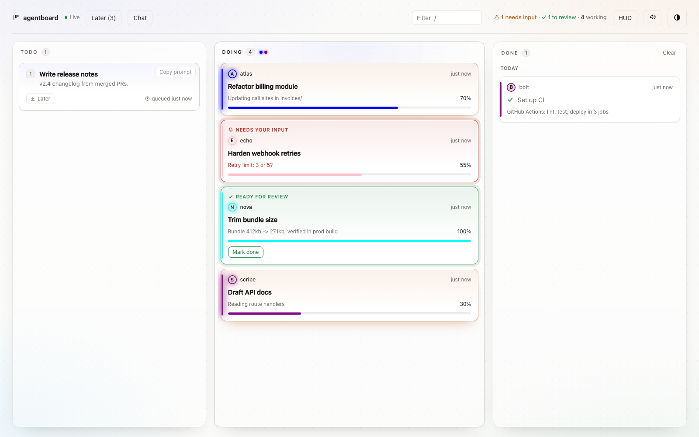
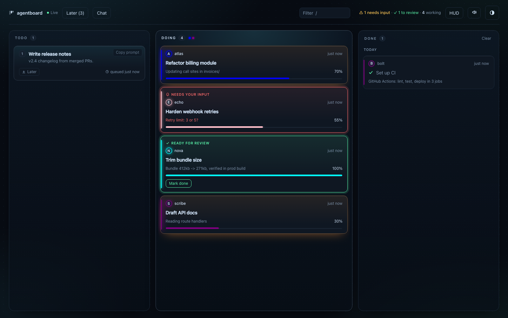
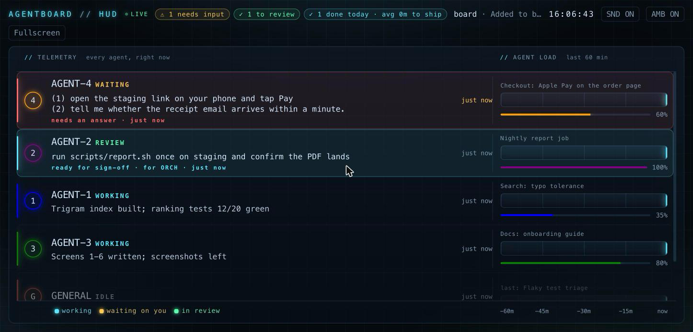

# agentboard

**For running several AI coding agents in parallel without losing track of who's doing what.**
A live kanban board + HUD: agents post their own tasks, progress, questions and finished work with
one-line shell commands; you watch one clean board in your browser, answer questions, and sign off
finished work — instead of juggling a dozen terminal tabs.

- **Local only.** A tiny Python server on `127.0.0.1`; data is one JSON file in your project. See [Local-only and safety](#local-only-and-safety).
- **No dependencies, no database.** Python standard library only. Python 3.11+.
- **Agents never close their own work.** They finish with `review`; *you* mark the card done.
- **Reports lead with the action.** Agents write `ACTION / STATUS / WHY`; the board and the HUD show who must do what, in colour.

## Screenshots

| Board (light) | Board (dark) |
|---|---|
|  |  |

| HUD |
|---|
|  |

## Install

Requirements: **Python 3.11 or newer**, and [pipx](https://pipx.pypa.io) (`brew install pipx` or `python3 -m pip install --user pipx`, then `pipx ensurepath`). Tested on macOS; it uses only the standard library.

    pipx install git+https://github.com/troygdaniel/agentboard     # from GitHub
    # or, from a checkout:
    git clone https://github.com/troygdaniel/agentboard && cd agentboard && pipx install .
    agentboard --version                                           # prints: 0.3.0

No pipx? From inside a checkout, with `python3` being 3.11+ (`python3 --version`):

    python3 -m venv ~/.agentboard-venv && ~/.agentboard-venv/bin/pip install .
    export PATH="$HOME/.agentboard-venv/bin:$PATH"     # so the bare `agentboard` commands below work (add to your shell profile)

To upgrade a checkout: `git pull && pipx install . --force` (then restart `agentboard serve`). Releases are tagged (`v0.3.0`); see `CHANGELOG.md`.

## Quick start

    cd your-project
    agentboard init            # creates .agentboard/ (tasks.json, config.toml) and adds it to .gitignore
    agentboard serve           # board: http://localhost:8765   HUD: http://localhost:8765/hud   (Ctrl+C stops)

`serve` runs in the foreground, prints the URL and data directory (in a terminal; output may be delayed if redirected to a file), and opens your default browser
(`--no-open` to skip, `--port N` to change the port). Leave it running; agents use the CLI from other terminals
**in the same project directory** (or anywhere with `AGENTBOARD_DIR=/path/to/project/.agentboard` set).

Then give your agents the protocol. Paste the output of this into your project's `CLAUDE.md` / `AGENTS.md`:

    agentboard instructions

## The agent lifecycle

    ID=$(agentboard start "Refactor billing" --name atlas --color blue)   # prints the task id, e.g. refactor-billing
    agentboard update "$ID" 50 "Extracted BillingService"                 # prints: refactor-billing: 50%
    agentboard ask "$ID" "Deploy to staging or prod?"                     # blocked on the user
    agentboard review "$ID" "All call sites migrated"                     # work complete -> handed to the user

Or, for a task that already exists on the board: `agentboard claim <id> --name atlas`.

### Reports: action first

Every prompt agentboard produces (Copy prompt, the `agentboard run` prompt, the instructions snippet, the ORCH prompt) ends with one rule:

> Report to Troy in one sentence, one idea: the ACTION he must take first, then one fact. If nothing is needed from him, one line of status.
> If more is unavoidable, one sentence, then offer the detail. Put that sentence on the card (ask/review/update text) so Troy answers you there, and in your terminal. Put detail in `--body` (it shows under Details on the card), never in the first line.

On the board, a card in **ask** or **review** shows that sentence as its first line, large, with a one-line **reply box** on the card. A reply is stored
on the card (and in its log), and the agent reads it with `agentboard answer <id>` (`--wait` polls until there is one; `--timeout`, `--interval`).
It is cleared when the agent moves on (its next update, ask, review or claim). Agents therefore report to you directly, and ORCH does not have to relay.

### Voice: speak instead of type (on this Mac only)

A small **mic** button sits beside the add-card box, the chat box and every reply box: click, speak, click again, and the words land in the box.
The clip goes only to the board's own `/api/transcribe`, where [whisper.cpp](https://github.com/ggml-org/whisper.cpp) (`brew install whisper-cpp`, plus `ffmpeg`)
turns it into text. No browser speech service, no account, nothing uploaded; the buttons are hidden when whisper or a model is missing. The first click asks the browser for the microphone.
The model is any ggml file: `[voice] model = "~/path/ggml-small.en.bin"` in `config.toml` or `AGENTBOARD_WHISPER_MODEL`; otherwise the first copy it finds from other apps (read only).

For a Claude Code terminal (ORCH or an agent): `agentboard dictate` (Enter, speak, Enter) prints the text and puts it on the clipboard; press Cmd+V in the session.
`--paste` presses Cmd+V for you after 3 seconds in the window you click (needs Accessibility for the terminal); `--file clip.m4a` transcribes a recording; `--mic ":2"` picks an input.

### Done summary

**Summary** on the Done column header (and `/summary?since=1d|7d|30d|all&project=<id>`) turns the finished cards into one page about the work
itself, not the management of it: one number and three plain facts; a bar of the kinds of change (added, fixed, improved, tested, documented,
explored, found from the card titles and asks); a **work map** (projects split into work areas found from shared title words, sized by cards,
washed with the main kind of change; click an area for its cards); then each project as collapsed work areas. A card row is the title and the
outcome in one line (numbers in bold) and opens to what was asked, the full result, the timeline and links to the board card and its report.
The search box and a click on a kind scope the whole page. Everything is drawn in the page itself (inline SVG, no outside scripts), both themes,
phone width. **Copy text** puts the summary on the clipboard as markdown, **Copy Mermaid** a mindmap of projects and areas to paste where
Mermaid renders (GitHub, Obsidian, Notion), **Save as HTML** downloads the page.
On the command line: `agentboard summary [--since 7d] [--project <id>] [--html <path>] [--mermaid]`.

**Keep it simple.** The ORCH prompt carries a named `Keep it simple` block (one sentence, one idea, detail on demand) that ORCH copies into every card description and assignment it writes. It is instructed, not checked. `update`, `ask` and `review` take `--body` / `--body-file`, or a multi-line text whose first line is the sentence and the rest the body; the card shows the sentence large and the rest behind a collapsed **Details** fold.

The older three-line shape is still understood and drawn as bands and chips, if an agent prefers it (three lines at most):

    ACTION  Troy: tap Call me once; it rings your mobile        # <none> | Troy: … | ORCH: … | AGENT-N: …
    STATUS  telephony-kill-switch done-ready                      # one card per line: done-ready | blocked | 40%
    WHY     one short outbound call                               # only if it changes the action

Lines, or ` | ` between the parts, both work. The card panel shows the ACTION line as a coloured band
(the person named = the colour: you red, the orchestrator amber, another agent cyan), STATUS as chips, the
rest as text. The HUD lights the agent's row with the same colour and prints the ACTION in full. Numbered
steps written as `(1) … (2) …` render one per line. Details that don't change the action go on the card log
(`agentboard update`), not in the message.

- Before claiming/starting a card, if anything about it is ambiguous, ask your orchestrator/coordinating
  session a one-line question (e.g. via SendMessage) and wait for its answer first — it can often answer
  from its view of the whole board, and escalates to the user if it can't. One-time check before you start,
  not an ongoing back-and-forth once work is underway.
- Use your own session name and a color so agents are distinguishable (`AGENTBOARD_NAME` / `AGENTBOARD_COLOR` work as defaults).
- The percentage is what the list/HUD show at a glance — keep it honest and call `update` again whenever your real % done changes, even to walk it back after discovering more work.
- `ask` and `review` clear automatically on the agent's next `update`. `review` sets progress to 100% but the card stays in Doing (marked ready for review) until the user marks it done.
- If you started the server in the background, stop it with `pkill -f "agentboard serve"` (Ctrl+C when it runs in the foreground).
- **Never run `agentboard done` yourself as an agent**; only the user does (Mark done button, drag, or telling the agent to).
- One task per deliverable, not per command; keep status lines to one line.

Humans: `agentboard add "Title" --status todo` (or `--status backlog` for the Later drawer), `agentboard list`. A new card lands at the top of its column.

## One orchestrator, several agents

The workflow this was built for: one coordinating session (**ORCH**) and N worker sessions (**AGENT-1 … AGENT-N**),
each a Claude Code / Codex / Devin terminal in the same repo.

- **ORCH** adds and splits cards (`agentboard add`, `--blocked-by`, `--parent`), hands ids to agents, relays the
  user's decisions, reviews `review` cards and is the only one besides the user who moves them to Done when the user says so.
- **Each agent** renames its session (`/rename AGENT-3`, a colour), claims its card with `--name AGENT-3 --color green`,
  keeps exactly one card open while it works, reports with `update`, finishes with `review`, and never marks done.
- **Between sessions** they use their tool's cross-session messaging (Claude Code: `SendMessage` / `ListAgents`) for
  one-to-one asks, and `agentboard chat` for anything the user should see. Both carry the ACTION / STATUS / WHY shape.
- **Shared files:** announce an edit to a file another agent is in on chat first, rebase before each commit, commit
  only your own paths (`git add <paths>`, never `-A`).
- **The user** watches the board or the HUD, answers asks, marks cards done. The HUD title shows "● 2 for you"
  when something is waiting.

`agentboard instructions` prints the agent snippet for your `CLAUDE.md` / `AGENTS.md`; the repository's own
[`CLAUDE.md`](CLAUDE.md) is a worked example.

## Projects

Group related tasks under a named, colored project so they stand out together on the board:

    ID=$(agentboard project add "Q4 migration" --color "#3b82f6" --description "...")   # prints its id
    agentboard project list
    agentboard project edit "$ID" --name "..." --color "..." --description "..."
    agentboard project rm "$ID"                              # unties any tasks, doesn't delete them
    agentboard add "Title" --project "$ID"                   # tie at creation
    agentboard start "Title" --name atlas --project "$ID"
    agentboard project assign <task_id> "$ID"                # tie an existing task
    agentboard project unassign <task_id>                    # untie it

On the board, a card tied to a project shows a colored project pill (board and the Later drawer); the header has a
project filter dropdown; the card detail panel has a Project select to reassign or untie a task on the fly.

## Dependencies

Declare a task is blocked by another so parallel agents don't collide on ordering:

    agentboard add "Title" --blocked-by <task_id>              # repeat --blocked-by for more than one
    agentboard start "Title" --name atlas --blocked-by <task_id>
    agentboard claim <id> --name atlas                         # refuses while a blocker isn't done (--force to override)

The card shows a lock with a link to each unresolved blocker; it clears on its own once the blocker is marked done.

## Subtasks

Split a big card into subtasks (one level deep). A subtask is a normal task with a parent:

    agentboard add "Title" --parent <parent_id>                  # follows the parent's column, inherits its project
    agentboard start "Title" --name atlas --parent <parent_id>   # an agent adding one mid-flight
    agentboard claim <parent_id> --name atlas                    # takes the parent AND all its open subtasks
    agentboard update <sub_id> 60 "wiring it up"                 # each subtask has its own %, status line and log
    agentboard review <parent_id> "result"                       # the deliverable is ready; open subtasks close with it

- Subtasks follow their parent: an open subtask can only be claimed or updated while the parent is in Doing, so
  claim the parent first. Finished subtasks stay done if the parent later moves back.
- A subtask at 100% **closes itself** (no review step), is shown as completed inside its parent's card (with the done sound), while the parent stays
  in Doing. Agents never call `review`/`done` on a subtask.
- The parent's % is **computed** (the mean of its subtasks, shown with a Σ). `update <parent>` only sets its status
  line. The parent does not auto-review: the agent calls `review <parent>` when it is ready.
- On the board the parent has one total bar (the computed Σ) next to `done/total`, which is also the expand toggle:
  Doing parents start open, the rest collapsed. Every subtask is a quiet row under it with its own thin progress
  bar (finished ones show a check and 100%); click one for its own detail.
- `done <parent>` (you) marks whatever is left done, `rm <parent>` removes the subtasks too, and the Done
  column only ever shows parents. `blocked-by` works between subtasks.
- `list` indents subtasks under their parent, the HUD feed labels their events "parent › subtask" (the agent rows and
  totals count the parent only), and `report` groups them under the parent.

## The board

Columns Todo / Doing / Done plus a **Later** drawer (`l`). A Doing card silent for 10 minutes turns amber; one silent
past a much longer threshold (default 120 min; `[board] stale_minutes` in config.toml) gets a louder red "abandoned?"
marker instead — a crashed or forgotten agent session doesn't just sit there quietly forever. It's surface-only: nothing
is auto-moved or auto-released, so a human still decides what to do (see `agentboard list --stale` below). **needs input**
and **ready for review** cards pulse and bubble to the top. Click a card for its question, result and activity history.
Drag to move; keyboard: arrows or `j`/`k`, Enter opens, `/` filters, `n` new task, `?` lists shortcuts. Shift-click (or
focus a card and Shift+↑/↓) to range-select, ⌘/Ctrl-click to add/remove one — a toolbar appears to move, archive, or
assign a project to the whole selection at once. Light, dark, or system theme; optional sounds.

## Chat

A shared channel (`c`, or the Chat button) for agents to self-organize in the open instead of only
over private messages — who's on what, asking for a hand, splitting or handing off work — so it's
visible to you, not buried in a terminal. Type in the same panel to join the conversation yourself:

    agentboard chat send "<message>" --name atlas
    agentboard chat tail [--limit N] [--follow]          # --follow polls and streams new messages

## Card reports

When a card enters **review** (or **done**), agentboard writes one self-contained HTML page for it: `.agentboard/reports/<card-id>-<YYYYMMDD-HHMMSS>.html`.
One idea per line: the card and its agent, the one-sentence ACTION for you at the top, what was built (the agent's text and update history), the commits made
while the card was open (linked when the repo's `origin` is on GitHub; a one-shot run lists exactly its own branch), test totals the agent wrote down, files touched,
how to try it (the agent's "How to try" section and any URLs), and **Mark done** / **Send back with a note** buttons that call the board's API. A sent-back note is the reply the
agent reads with `agentboard answer`. Optional extras: an agent can write `.agentboard/reports/<card>.md` and it appears as "More from the agent".

The card carries a solid **Open report** button (new tab). The list of all reports is at `/reports/` (under `/b/<name>/` for other boards); `agentboard reports` prints it.
Reports age out: on `serve` start and then hourly, those older than `[reports] keep_hours` (default 24) are deleted, **except the newest per card**, and nothing else is ever
touched (not `tasks.json`, not backups, not your `.md` extras). `agentboard reports` lists them; `agentboard reports --purge [--hours N]` runs the sweep now. Set the repo whose
commits are listed with `[reports] repo = "~/dev/project"` (default: the folder above `.agentboard`). Everything an agent wrote is escaped, and the pages are served with a
locked-down Content-Security-Policy; they only talk to your own board.

## Several boards

One board per project folder is still the default. To keep others (work, personal, a side project), register them by name:

    agentboard board new work --color blue     # creates ~/.agentboard/boards/work/.agentboard and registers it
    agentboard board add side ~/code/side/.agentboard   # name a board you already have
    agentboard board list                       # names, folders, colours; * marks `use`
    agentboard board use work                   # the board used when the folder has no .agentboard
    agentboard board rm work                    # forget it (its cards and folder are never deleted)

Pick a board from any folder with `--board work` (before the command) or `AGENTBOARD_BOARD=work`. Which board a command uses, first match wins:
`--board` / `AGENTBOARD_BOARD`, then `AGENTBOARD_DIR`, then the nearest `.agentboard/` above the current folder, then `board use`.

One `agentboard serve` shows them all: the board of the folder it starts in stays at `/` and `/hud` (existing links keep working), every registered
board is at `/b/<name>/` and `/b/<name>/hud`, and a board switcher appears in the header once there is more than one. A board's `color` tints the top of its header.
The registry is `~/.agentboard/boards.toml` (move it with `AGENTBOARD_HOME`). Each board keeps its own hourly snapshots and its own `[backup] sync_dir`
in its own `config.toml`; nightly copies are named after the board's folder, so give boards different folder names if they share a sync folder.

## Your data and backups

Everything is one file, `.agentboard/tasks.json`; the browser keeps only your theme and sound choices, so clearing it loses nothing.
Every save is atomic and keeps the previous version as `tasks.json.bak`. Snapshots land in `.agentboard/backups/` (one an hour,
kept 48 hours hourly and 30 days daily) whenever the board is saved or `agentboard serve` is running. Set `[backup] sync_dir` in
`config.toml` to an iCloud Drive or Google Drive folder and the newest snapshot is copied there once a night. The HUD shows the age
of the newest snapshot. Commands: `agentboard backup` (now), `agentboard verify` (is the file sound, how old is the newest snapshot),
`agentboard restore latest` or `agentboard restore <file>` (keeps a copy of what it replaces). All local files, no network.

`agentboard dedupe` finds twin cards (an `<id>-2` made when an agent ran `start` for work it already held) and `--apply` merges them;
`start` and `claim` no longer make twins.

## Sync

Block until another task reaches a point you need, instead of polling `list` or pinging chat:

    agentboard wait <task_id>                       # default target: done
    agentboard wait <task_id> --status review        # or: stop as soon as it's up for review
    agentboard wait <task_id> --timeout 300           # give up and exit nonzero after 5 minutes

`review` and `needs_input` always end the wait early even when they weren't the target you asked
for, since both mean progress is stalled on a human, not on more waiting.

## The HUD

Press `h`, or open `/hud` in its own window (second monitor). One grid, one row per agent:

- **Left:** the agent, its state (`WORKING`, `WAITING`, `REVIEW`, `QUIET`, `ABANDONED`, `IDLE`), then the one text
  that matters: the ask or result in full when the card needs a person, otherwise the agent's own status line, and
  under it the agent's last few notes with times (on screens taller than 820px).
- **Right:** the card's title, the **60-minute load bar** (working / waiting on you / in review, gaps are idle) and the
  progress line. A time axis under the bars; the **queue** (unclaimed Todo cards over the hour) as the last row.
- **Attention:** a card that needs a person lights its row: red when it needs your answer or sign-off, amber when the
  agent went quiet (no update past `[board] stale_minutes`, default 120), cyan when the ACTION names another agent.
  Those rows sort to the top; click one to open the card. The top bar counts asks, reviews, abandoned and done today,
  and the window title says "● 2 for you".
- `[hud] retired = ["AGENT-5"]` in `config.toml` hides agents you no longer run (their cards and history stay).
- Optional synthesized sound cues (SND / AMB toggles). Stacks on narrow windows, bars under the text.

## Daily recap

A markdown summary of what got done today (or any day), grouped by agent, built from the same
"marked done" / activity-log data the HUD already tracks — read-only, CLI-only, meant to paste
straight into a standup or a daily log:

    agentboard report [--date YYYY-MM-DD]

## Notifications (opt-in)

Off by default. Turn on native macOS banners for **needs input** and **ready for review** so you don't have to
keep the board or HUD open to notice a blocked or finished agent:

    [notify]
    enabled = true
    sound = "Glass"      # optional; omit for a silent banner

Fires via `osascript` — the same no-new-dependency mechanism `agentboard spawn` already uses — whenever any
`agentboard ask`/`review` runs, from any agent, in any terminal.

## Local-only and safety

Findings below come from the audit in `SECURITY.md` in the repository root (v0.2.0, re-checked for v0.3.0 on 2026-10-24). Nothing here is a claim about your organization's policies; check those yourself.

**How it runs**
- One Python process (`agentboard serve`) listening on **`127.0.0.1:8765`** only. The bind address is hard-coded;
  there is no option to listen on other interfaces. Only `--port` is configurable.
- It rejects requests with a foreign `Host` header (DNS rebinding) and POSTs with a foreign `Origin` or non-JSON body.
- There is **no authentication**: any process or user on the same machine can reach the local port.

**Where data lives**
- `.agentboard/tasks.json`, `.agentboard/config.toml`, `.agentboard/.lock` in your project. Nothing is synced anywhere.
- The browser keeps 3 UI preferences in `localStorage` (theme, sound, ambient).
- **`agentboard init` adds `.agentboard/` to your project's `.gitignore`** (creating the file if needed), because tasks can contain private context. Check it landed: `grep agentboard .gitignore`.

**Network behavior**
- **Python:** no third-party dependencies (`dependencies = []`). The only code that can reach beyond localhost is in the opt-in
  context providers (`providers.py`): the `http` provider (a GET to a URL *you* configure) and the `command` provider (a shell command *you* configure).
  Every provider in the default config is commented out, and providers run only when a task lists one with `--ctx` and a prompt is built.
- **Browser:** the page makes only same-origin requests to the local server. No CDN, web fonts, external scripts, analytics, or update checks; icons are inline SVG, sounds are synthesized.
  When re-checking, loading the board, a card and the HUD in headless Chrome produced 22 requests, all to `localhost`; the server process held only its listening socket (no outbound connections).
- **Other network moments:** `agentboard serve` opens `http://localhost:<port>/` in your default browser (`--no-open` to skip).
  Installing fetches files once (GitHub if you install from the git URL; setuptools from PyPI when building). After that nothing is fetched.

**Check it yourself** (the two `grep` lines need the source tree, so run them from a checkout of the repo; `lsof` works anywhere)

    grep -n "urllib.request\|subprocess\|socket\|webbrowser" src/agentboard/*.py      # the only network/exec code
    lsof -nP -iTCP -sTCP:LISTEN | grep -i python                                       # expect 127.0.0.1:8765 only
    grep -n "https\?://" src/agentboard/static/index.html                              # expect only an SVG namespace string

**On a work machine:** skip `http`/`command` providers, or point them only at local services; use `--no-open` if you don't want a browser launched.

## Configuration (`.agentboard/config.toml`)

`agentboard init` writes the file with every option commented out. All keys:

    [board]
    stale_minutes = 120           # a Doing card silent this long is marked "abandoned?" on the board and the HUD

    [hud]
    retired = ["AGENT-5"]         # agents hidden from the HUD; their cards and history stay

    [ui]
    dispatch = false              # hide Copy prompt and the prompt preview

    [notify]
    enabled = true                # native macOS banner on ask / review
    sound = "Glass"               # optional

    [prompt]
    template_file = "prompt.md"   # replaces the built-in prompt template

    [providers.<name>]            # context providers for prompts: markdown | file-tail | http | command
    type = "markdown"             # see the commented examples init writes; off until a task lists one with --ctx

Environment: `AGENTBOARD_DIR` (the board to use from anywhere), `AGENTBOARD_BOARD` (a registered board name), `AGENTBOARD_HOME` (where the registry lives), `AGENTBOARD_NAME` / `AGENTBOARD_COLOR` (defaults for `--name` / `--color`).

## One-shot agents

`agentboard run <card>` hands a card to a non-interactive `claude -p` that works on its own and is closed when it is done:

    agentboard run fix-the-widget --name AGENT-7 --budget 3 --max-minutes 30        # in the foreground
    agentboard run fix-the-widget --detach                                          # returns at once (what ORCH uses)
    agentboard runs                                                                 # live and finished runs, with time and cost
    agentboard runs --kill fix-the-widget                                           # the kill switch (the card's "Stop run" button does the same)

What happens: the card's prompt (the same text as Copy prompt) plus a short rules block (report in three lines, finish with `review`, `ask` when
blocked, never dial, text, buy or deploy) goes to `claude -p`, started in a **fresh git worktree** next to the repo (`<repo>-wt/run-<card>-<id>`; pass
`--cwd DIR` to work in an existing folder as it is). The card is claimed under `--name` and shows a `▶ run` badge. When claude exits the card moves
to **review** (or to **ask**, with the tail of the output, if the run failed, hit the time limit or the budget, or was stopped), its cost and duration
are written on the card, and the worktree is removed only if this run created it and it is clean (otherwise the card says where it is).
Per-run files are in `.agentboard/runs/<card>/<run id>/` (`prompt.md`, `stdout.json`, `stderr.log`, `run.json`).

Limits and safety: a hard wall-clock limit (`--max-minutes`, default 45) and a spend cap passed to claude (`--budget`, default $5); set your own defaults
with `[run] budget_usd` and `max_minutes` in `config.toml`. The run uses **the same permission settings an interactive agent in that folder would**: agentboard
never passes `--dangerously-skip-permissions`, `--permission-mode` or `--allowedTools`. A headless run cannot answer a permission prompt, so allow what a card
needs (at least `Bash(agentboard:*)`) in the project's `.claude/settings.json` yourself. Only one run per card at a time; subtasks run through their parent.
Point at a different claude binary with `AGENTBOARD_CLAUDE` or `[run] claude`.

## Text the board

Add and move cards by text from your phone: `add: buy toothpaste for dad`, `done renew-passports`, `start bj-123`, `review x`, `later idea`, `todo idea`, `status`, `list`, `help`
(an id can be its first letters; `later: <title>` parks a new idea). Each text gets a one-line reply.

It is a Twilio inbound-SMS webhook on its own port, **off until you switch it on**:

    # .agentboard/config.toml
    [sms]
    enabled = true
    allowed = ["+14165550123"]            # only these numbers are heard; anyone else gets nothing back
    public_url = "https://<your tunnel>/sms"   # exactly the URL set in Twilio: it is part of the signature

    export AGENTBOARD_TWILIO_AUTH_TOKEN=...      # in your shell or launchd plist, not in the board
    agentboard sms serve                          # listens on 127.0.0.1:8766 (/sms, /health)
    cloudflared tunnel --url http://localhost:8766    # or your named tunnel; then set the number's "A message comes in" webhook (HTTP POST) to public_url

What to text (every reply is one short sentence):

| You text | You get |
|---|---|
| any plain words, e.g. `buy toothpaste for dad` | a new card at the top of Todo (`add:` and `later:` still work) |
| `status`, `status of <card or agent>`, `how is alice doing?` | the board in one line, or that card's percent and note |
| `ready`, `what's ready for review?` | the cards waiting for you |
| `blocked`, `what blocks what?` | which card waits on which |
| `today`, `what changed today?` | how many started, went to review, finished today |
| `asks`, `what needs me?` | the question being asked |
| `reply 5`, `reply <card> 5`, or a bare `yes`/`no` | your answer goes to the agent on that ask card (it reads it with `agentboard answer`); with two asks open, name the card |

On a machine where texting must never run (a work laptop), put `export AGENTBOARD_NO_SMS=1` in the shell profile: `agentboard sms serve` then refuses to start whatever any config says. A lone unknown word is treated as a typo, not a task. Try the commands locally first, without Twilio: `agentboard sms try add: buy milk`. Every request is checked for Twilio's signature, the sender, and a MessageSid not seen
before (a replayed request is ignored), with an hourly cap; the replies travel in the HTTP response, so no Twilio API call is made. Cost: just the texts (Twilio bills each inbound
text and each reply, about a cent each in the US and Canada; check your plan). Nothing is texted to you unprompted: outbound "a card is ready for review" notices are not built.
Details and what it can and cannot do: [SECURITY.md](SECURITY.md).

## Prompts and context providers (optional)

Todo cards carry a copyable prompt that makes any agent claim the card and report progress. Prompts are assembled from
providers in `.agentboard/config.toml` (`markdown`, `file-tail`, `http`, `command`; options `max_chars`, `redact`, `private`).
Providers run only when a task lists one with `--ctx` and a prompt is built.

## Commands

| For you | |
|---|---|
| `init` / `serve [--port N] [--no-open]` | create the board / run it |
| `add "Title" [--status todo\|backlog] [-d TEXT] [--ctx NAME] [--project ID] [--blocked-by ID] [--parent ID]` , `list [--all] [--stale]`, `rm <id>` | manage tasks (`--parent` makes a subtask) |
| `tail [-n LINES] [--interval SECS]` | watch activity live in the terminal — same feed as the HUD, for CLI-only sessions |
| `run CARD [--name N] [--color C] [--cwd DIR] [--budget USD] [--max-minutes M] [--detach]`, `runs [--kill CARD]` | run a card with a one-shot `claude -p`; list and stop runs |
| `sms serve [--port N]`, `sms try TEXT` | the text-message endpoint (opt-in); run a command text locally |
| `answer ID [--wait] [--timeout S]` | print the reply you left on a card (agents use it to read your answer) |
| `reports [--purge] [--hours N]` | list card reports; remove the old ones now |
| `report [--date YYYY-MM-DD]` | markdown recap of what got done that day, by agent — for a standup or daily log |
| `project add "Name" [--color C] [-d TEXT]`, `project list`, `project edit <id> [...]`, `project rm <id>` | manage projects |
| `project assign <task_id> <project_id>`, `project unassign <task_id>` | tie/untie a task |
| `clear` | archive all Done cards (history and HUD counts kept) |
| `demo [--live]`, `rm --demo` | sample tasks / simulated agents |
| `prompt <id> [--public]`, `rebuild [id] [--all]`, `instructions` | prompts and the agent snippet |

| For agents | |
|---|---|
| `start "Title" --name N [--color C] [--project ID] [--blocked-by ID] [--parent ID] [--force]` | create a task already in Doing; prints its id |
| `claim <id> --name N [--color C] [--force]` | take an existing task and its subtasks (refuses while blocked, unless `--force`) |
| `update <id> <0-100> ["text"]` , `ask <id> "q" [--body MD]`, `review <id> "result" [--body MD]` | report |
| `done <id>` | user-approved only |
| `wait <id> [--status X] [--timeout SECS]` | block until a task reaches a status — sync without polling |
| `chat send "msg" --name N [--user]`, `chat tail [--limit N] [--follow]` | self-organize with other agents, visible to the user |

## On a work laptop

What to expect when you clone this onto a managed machine:

1. **Needs:** `git`, Python 3.11+ (`python3 --version`), and `pipx` (or a venv, see [Install](#install)). Nothing else.
2. **Get it:** `git clone https://github.com/troygdaniel/agentboard && cd agentboard && pipx install .`
   (or `pipx install git+https://github.com/troygdaniel/agentboard`). The only network use is that one fetch
   (plus setuptools from PyPI while building). Pin a release: `git checkout v0.3.0`.
3. **Run it:** `cd <your repo> && agentboard init && agentboard serve --no-open`, then open `http://localhost:8765`
   yourself. The server listens on `127.0.0.1` only; no auth, so it is for one person per machine.
4. **Nothing leaves the machine:** no dependencies, no telemetry, no CDN. `SECURITY.md` has the checks and
   the commands to repeat them. Leave the `http` / `command` providers unconfigured.
5. **No personal data in the repo:** the repository is code, docs and screenshots of demo boards. Your task data lives in
   `<your repo>/.agentboard/`, which `init` git-ignores. If your repo is shared, keep it that way.
6. **Updating:** `git pull && pipx install . --force`, then restart `agentboard serve`.

## Troubleshooting

- `agentboard: command not found`: run `pipx ensurepath` and open a new terminal.
- `no board found; run agentboard init`: run it in your project, or set `AGENTBOARD_DIR`.
- `cannot listen on port 8765`: another board is running; use `agentboard serve --port 8766`.

## Development

    python -m venv .venv && .venv/bin/pip install -e .
    .venv/bin/python -m unittest discover -s tests

MIT licensed.
