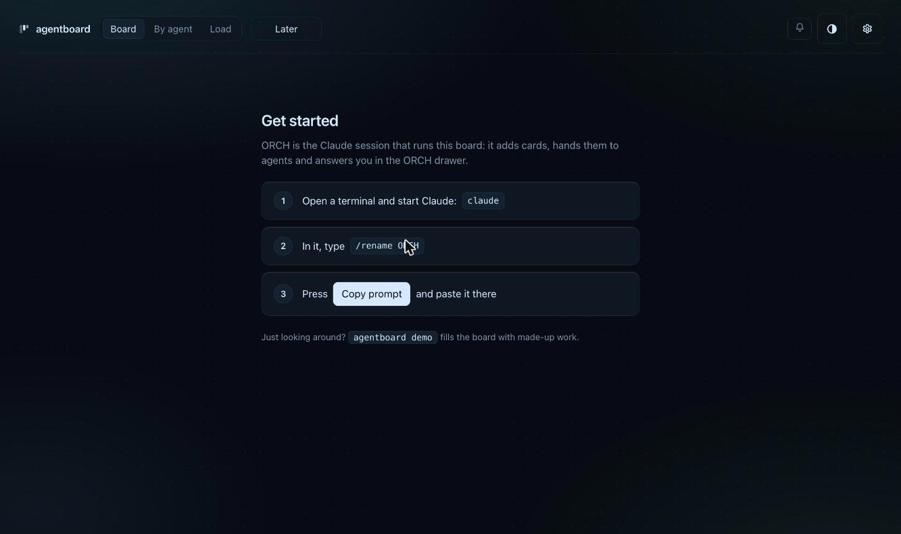
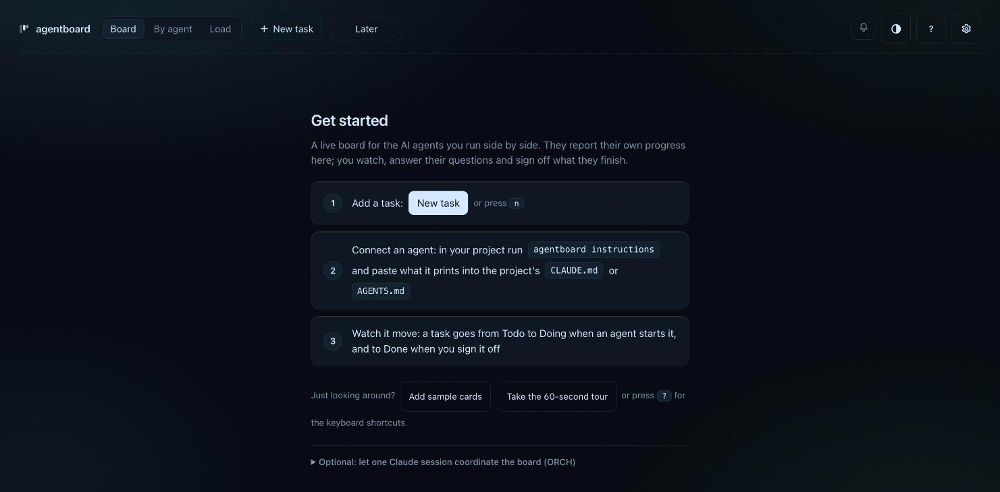
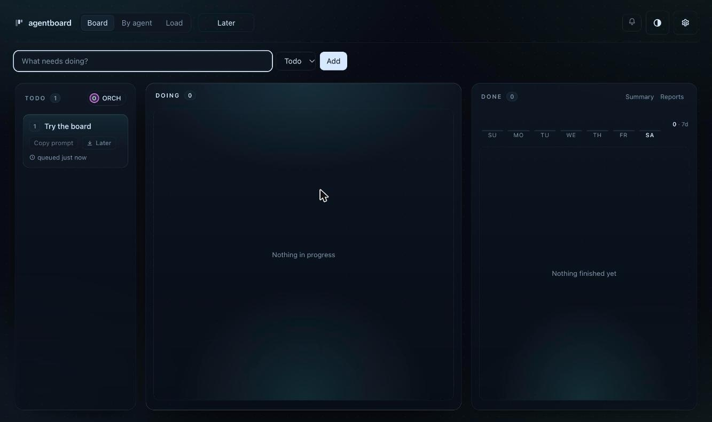
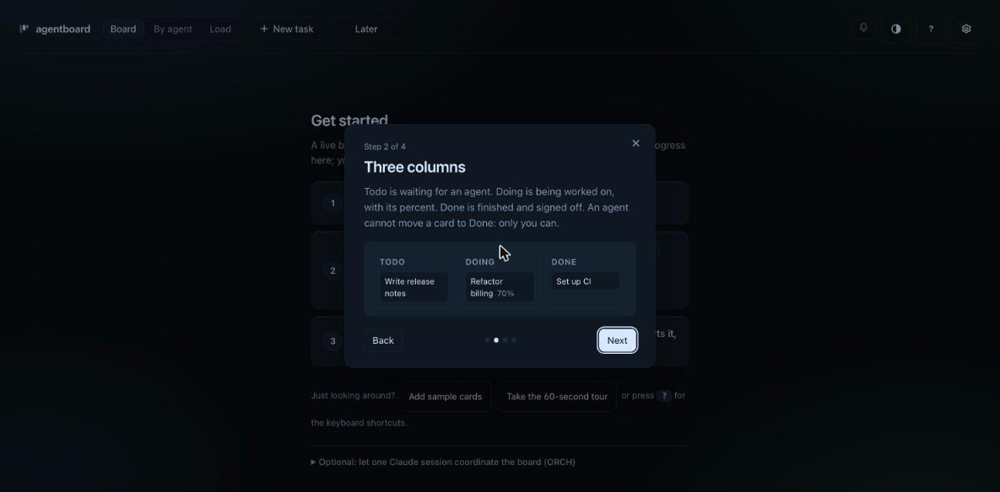
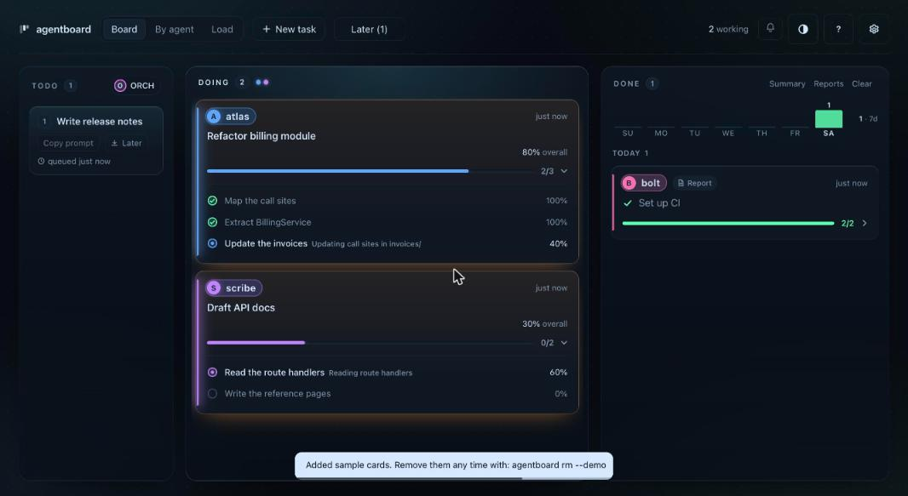
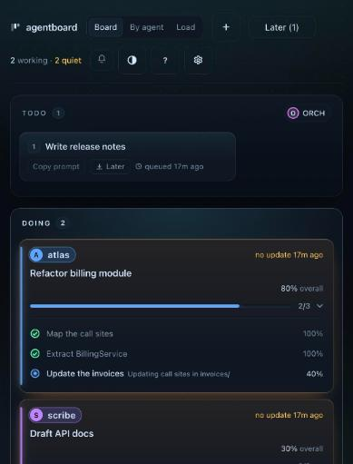

# Overnight: first-run experience and plain-language clarity (overnight-ux-firstrun)

Branch `overnight/overnight-ux-firstrun` (worktree `~/dev/agentboard-on-ux`), on top of main at 890a386. Nothing merged, nothing pushed.
Every screenshot and transcript below comes from a throwaway board with made-up cards, never the live one.

## The short version

A developer who had never seen agentboard hit a usage error on `agentboard`, a board with no visible way to add a card, a first screen
written for one Claude workflow (ORCH, `/rename`), no tour, and a few Python tracebacks. Now:

- `agentboard` with no arguments prints a ten-line welcome (what it is, three first steps) instead of an error.
- `agentboard init` is guided: at a terminal it asks one question (add sample cards?), then lists the next three commands. Run again, it says it changed nothing.
- The empty board has a visible **New task** button (header and step 1), **Add sample cards** (no terminal needed), a **60-second tour**, and a **?** button for the shortcuts. The first screen has no jargon; ORCH moved under "Optional".
- Mistakes say what to do next: a typo names the nearest command, an unknown id points at `agentboard list`, a bad port is one plain line, an out-of-range percent is said, not swallowed.

## Try it (two minutes)

    cd ~/dev/agentboard-on-ux                       # or: git checkout overnight/overnight-ux-firstrun
    rm -rf build && pipx install . --force          # then restart any running board
    mkdir /tmp/try && cd /tmp/try
    agentboard                                      # the welcome
    agentboard init                                 # asks about sample cards
    agentboard serve --port 8799                    # then press ? or use "Take the 60-second tour"

## The three personas, as written scripts, and what they hit

Each script was run on a clean folder with no `AGENTBOARD_*` variables and a fresh HOME (the CLI) and in the browser against a throwaway board.

### 1. First-time developer (has pipx, no agents running yet)

1. `agentboard` 2. `agentboard init` 3. `agentboard serve`, open the page 4. add a card 5. pretend to be an agent (`start`, `update`, `review`) 6. mark it done 7. find the shortcuts.

| # | Friction (before) | Fix (after) |
|---|---|---|
| F1 | `agentboard` alone: a usage error listing 46 command names | A welcome, exit 0 |
| F2 | A typo (`strat`) dumped all 46 names, no suggestion | "Did you mean: start?" in two lines |
| F3 | `init` printed a path and one next step that skipped agents | Guided: asks about sample cards at a terminal, lists serve, demo, instructions; says "already set up" on a second run; notes a board in a folder above |
| F4 | On an empty board the only way to add a card was the hidden key `n` | A visible **New task** button in the header and in step 1 (the key stays) |
| F5 | The first screen: "ORCH is the Claude session that runs this board", `/rename ORCH`, Copy prompt | Plain three steps (add a task, connect an agent with `agentboard instructions`, watch it move); ORCH folded under "Optional" |
| F6 | Sample data only from the terminal (`agentboard demo`), and the Doing samples carried an amber "No subtasks yet" warning | **Add sample cards** button; the samples now have their steps, so the first board looks like a good one |
| F7 | No tour; shortcuts only through the hidden `?` key | **?** button in the header; a four-step 60-second tour from the first screen and from the shortcuts sheet |
| F8 | Empty columns spoke the agents' language ("agents claim work from here") | "Nothing queued. Add a task (n), and an agent picks it up from here" and the Doing and Done equivalents |
| F9 | `agentboard list` on an empty board printed nothing | At a terminal only: how to add a task or try the demo (a script's output is unchanged) |
| F10 | `update try-it 150` silently became 100 | Says "150 was taken as 100" |
| F11 | The "every card gets subtasks, the agent adds them" reminder printed to a person typing `agentboard add` | Printed for agents (not at a terminal) only |
| F12 | The "plugins are off" line followed any typo, even with no plugin installed | Only when a plugin package is installed (found from package metadata, nothing imported) |

### 2. Power user with six agents

1. Start six agents with two subtasks each 2. one asks a question, one finishes 3. find one agent's work 4. By agent view 5. keyboard through cards 6. answer.

| # | Friction (before) | Fix (after) |
|---|---|---|
| F13 | `list` had no filter by agent, and `--status` took any word (a typo returned nothing) | `list --agent NAME` (any capitals); `--status` takes a real column and says so otherwise |
| F14 | Two agents' "Step one" became `step-one`, `step-one-4`...: the id does not say whose | **Filed** as card `ux-subtask-ids-collide-across-agents-ste` (touches the store; not done overnight) |
| F15 | By agent at 1333 px: the sixth lane is off-screen with no cue | **Filed** as card `ux-by-agent-hides-lanes-past-the-fifth-w` (visual polish area) |
| F16 | An unknown id said only "no such task" | Adds "(`agentboard list` shows the ids)" |

What already worked well: the header's "1 needs input, 1 to review, 6 working" line, the quick-reply chips on an ask, the lane header words (WORKING, ASK, REVIEW).

### 3. Work-PC user (Python and pipx only, no admin, nothing but localhost)

1. `agentboard doctor` 2. `agentboard init` 3. `agentboard serve` (the browser may not open) 4. a port already taken 5. a mistyped port.

| # | Friction (before) | Fix (after) |
|---|---|---|
| F17 | `serve --port 99999` ended in a Python traceback | One line: "--port must be a number from 1 to 65535 (the default is 8765)" |
| F18 | `serve -h` explained nothing | Says the default port and what `--no-open` does |
| F19 | `serve` did not say the board is for this computer only, or what to do when no browser opens | Adds "open that address in your browser; it listens on this computer only (127.0.0.1)" |
| F20 | A first board has Sound, an Ambient bed and Touch ticks on by default | **Not changed** (taste): filed as the decision card `decision-should-sound-be-off-on-a-board`; options in the card |
| F21 | README install and uninstall steps for a locked-down machine | Belongs to the card `overnight-install-quickstart`; not touched here |

What already worked well: `doctor`'s one-line WARN about `AGENTBOARD_LOCKDOWN` and what it stops, and the busy-port message that suggests the next port.

## Before and after

Screenshots (throwaway board, dark theme):

| Before | After |
|---|---|
|  |  |
|  |  |
| |  |
| |  |

Terminal, before and after, from the old source (890a386) and this branch run side by side on clean folders (this Mac has a plugin installed, so the
"plugins are off" line that follows a typo here is left out of both: a stranger never sees it, which is fix F12):

### A bare `agentboard`

Before:

```
$ agentboard 
usage: agentboard [-h] [--version] [--board NAME]
                  {init,add,move,edit,list,tail,backup,restore,doctor,verify,dedupe, ...
agentboard: error: the following arguments are required: cmd   [exit 2]
```

After:

```
$ agentboard 
agentboard 0.3.1: a live board for the AI coding agents you run in parallel. Local only: no account, nothing leaves this machine.

New here? In your project folder:
  agentboard init           set up a board here
  agentboard serve          show it in your browser (http://localhost:8765; Ctrl+C stops it)
  agentboard instructions   the lines to paste into your agents' CLAUDE.md or AGENTS.md, so they report to it

Day to day:
  agentboard list           what is on the board          agentboard add "Fix login" --status todo
  agentboard demo           sample cards to look around   agentboard doctor    check this install

Help for any command: agentboard <command> -h.   Every command: agentboard -h
```

### A typo

Before:

```
$ agentboard strat x
usage: agentboard [-h] [--version] [--board NAME]
                  {init,add,move,edit,list,tail,backup,restore,doctor,verify,dedupe, ...
agentboard: error: argument cmd: invalid choice: 'strat' (choose from init, add, move, edit, list, tail, backup, restore, doctor, verify, dedupe, ... plugins)
```

After:

```
$ agentboard strat x
agentboard: invalid choice: 'strat' (no such command). Did you mean: start?
Run `agentboard` with no arguments for the short guide, or `agentboard -h` for every command.
```

### `agentboard init` (not at a terminal: no question)

Before:

```
$ agentboard init
initialized ~/my-project/.agentboard
added .agentboard/ to .gitignore (task data can hold private context)
next: agentboard add "My first task" --status todo && agentboard serve
```

After:

```
$ agentboard init
set up a board: ~/my-project/.agentboard
added .agentboard/ to .gitignore (task data can hold private context)
next:
  agentboard serve         show the board in your browser (http://localhost:8765; Ctrl+C stops it)
  agentboard demo          sample cards, to look around first (`agentboard rm --demo` removes them)
  agentboard instructions  the lines to paste into your agents' CLAUDE.md or AGENTS.md, so they report here
```

### An out-of-range percent

Before:

```
$ agentboard start "Try it" --name me
try-it
try-it has no subtasks yet: add at least two now (do it, check it), then work them:
  agentboard add "<step>" --parent try-it
$ agentboard update try-it 150 "too far"
try-it: 100%
```

After:

```
$ agentboard start "Try it" --name me
try-it
try-it has no subtasks yet: add at least two now (do it, check it), then work them:
  agentboard add "<step>" --parent try-it
$ agentboard update try-it 150 "too far"
try-it: 100%
note: progress is 0 to 100; 150 was taken as 100
```

### An unknown id

Before:

```
$ agentboard update nope 5 x
agentboard: no such task: nope   [exit 1]
```

After:

```
$ agentboard update nope 5 x
agentboard: no such task: nope (`agentboard list` shows the ids)   [exit 1]
```

### A port that cannot be one

Before:

```
$ agentboard serve --port 99999
Traceback (most recent call last):
  ... (twelve lines of Python stack) ...
OverflowError: bind(): port must be 0-65535.   [exit 1]
```

After:

```
$ agentboard serve --port 99999
agentboard: --port must be a number from 1 to 65535 (the default is 8765), got 99999   [exit 1]
```

### `serve -h`

Before:

```
$ agentboard serve -h
usage: agentboard serve [-h] [--port PORT] [--no-open]

options:
  -h, --help   show this help message and exit
  --port PORT
  --no-open
```

After:

```
$ agentboard serve -h
usage: agentboard serve [-h] [--port PORT] [--no-open]

options:
  -h, --help   show this help message and exit
  --port PORT  the port to listen on (default 8765); try another when it is
               busy
  --no-open    do not open a browser window (the address is printed either
               way)
```

### `list` by agent

Before:

```
$ agentboard list --agent atlas
usage: agentboard [-h] [--version] [--board NAME]
                  {init,add,move,edit,list,tail,backup,restore,doctor,verify,dedupe, ...
agentboard: error: unrecognized arguments: --agent atlas   [exit 2]
```

After:

```
$ agentboard list --agent atlas
task-of-atlas                  doing       5%  [atlas]  Task of atlas
```

### `demo`, then `list`

Before:

```
$ agentboard demo
added sample tasks (ids start with demo-); remove with: agentboard rm --demo
$ agentboard list
demo-release-notes             todo        0%  [Unassigned]  Write release notes
demo-audit                     backlog     0%  [Unassigned]  Audit npm dependencies
demo-billing                   doing      70%  [atlas]  Refactor billing module
demo-docs                      doing      30%  [scribe]  Draft API docs
demo-ci                        done      100%  [bolt]  Set up CI
```

After:

```
$ agentboard demo
added sample tasks (ids start with demo-); remove with: agentboard rm --demo
$ agentboard list
demo-release-notes             todo        0%  [Unassigned]  Write release notes
demo-audit                     backlog     0%  [Unassigned]  Audit npm dependencies
demo-billing                   doing    Σ 80%  [atlas]  [2/3 subtasks]  Refactor billing module
  ↳ demo-billing-map           done      100%  [atlas]  Map the call sites
  ↳ demo-billing-extract       done      100%  [atlas]  Extract BillingService
  ↳ demo-billing-invoices      doing      40%  [atlas]  Update the invoices
demo-docs                      doing    Σ 30%  [scribe]  [0/2 subtasks]  Draft API docs
  ↳ demo-docs-routes           doing      60%  [scribe]  Read the route handlers
  ↳ demo-docs-write            doing       0%  [scribe]  Write the reference pages
demo-ci                        done     Σ100%  [bolt]  [2/2 subtasks]  Set up CI
  ↳ demo-ci-jobs               done      100%  [bolt]  Write the lint, test and deploy jobs
  ↳ demo-ci-run                done      100%  [bolt]  Check a green run
```


At a terminal two things show that a pipe cannot: `agentboard init` asks "Add a few sample cards so the board is not empty? [y/N]", and an empty
`agentboard list` prints one line saying how to add a task. Both are pinned by tests that fake a terminal.

## Cross-review fix (AGENT-8, card xr-firstrun-demo-wrong-board, HIGH)

`agentboard init --demo` (and answering yes to the sample-cards question) seeded the twelve sample cards into the board that `AGENTBOARD_DIR`, `AGENTBOARD_BOARD` or `--board` named,
not into the board `init` had just made in the current folder: an agent session with `AGENTBOARD_DIR` exported (common) would have filled a live board with `demo-*` cards. Fixed:

- `init` seeds the board it created (`demolib.seed(Store(d))`), never the one `find_dir()` would pick. The sample cards are the only thing `init` writes besides the new board's own files and `.gitignore`.
- When the shell names a different board, `init` now says so: *note: AGENTBOARD_DIR is set to <path>, so agentboard commands in this shell use that board, not this new one; unset it to use this one.*
- The bare `agentboard` welcome had the same root cause (it said "This folder's board" for the board the variable named); it now says "The board in use (AGENTBOARD_DIR is set)".
- `agentboard demo` itself is unchanged: it is about the board in use.
- Tests (`tests/test_first_run.py`, class `InitNeverTouchesAnotherBoard`, 8 tests): a live board with a card and `AGENTBOARD_DIR` pointing at it, `init --demo` and the terminal "yes" in a new folder leave the live board's bytes unchanged and seed the new one; the note appears only when the variable names another board; a registered board (`AGENTBOARD_BOARD`, `--board`) is protected the same way; the welcome names the variable. 6 mutants (seeding through `_store()` or `cmd_demo`, no note, a note for the same board, the welcome's label, only one of the two variables), all caught.

## What changed, by file

- `src/agentboard/cli.py`: the welcome and the nearest-command error (a small `ArgumentParser` subclass); guided `init` (`--demo`, `--no-demo`); the hints on empty `list`, out-of-range percent, unknown id; `list --agent` and a validated `--status`; `serve` port check and help text; the `add` reminder for agents only; the plugin hint only when a plugin is installed.
- `src/agentboard/demo.py` (new): the sample cards, moved out of the CLI so the CLI and the page's button share them; each card in progress now has its steps; seeding twice is a no-op.
- `src/agentboard/server.py`: `POST /api/demo` (behind the same guard as every POST: same-origin, exact JSON type), and the extra line in `serve`'s output.
- `src/agentboard/static/index.html`: header **New task** and **?** buttons; the first screen rewritten; the four-step tour dialog (fixed text, focus kept inside, Esc and the arrow keys, focus returns to where it was, never opens by itself); plainer empty-column text.
- Tests: `tests/test_first_run.py` (34 new) and five existing source-pin tests updated on purpose (see Risks).

## Checks

- Full suite on this branch: **1228 tests, OK** (Nov 8 00:56 to 00:59, after the cross-review fix; it was 1220 before it). An earlier run under heavy machine load (load average 14, other agents running suites) failed three timing tests in `test_redact_dashes` and `test_redact_dos`; their code is untouched and they pass when the Mac is quiet.
- `python3 tests/publiccheck.py`: 0 findings.
- 37 mutants of the new code (each welcome, hint, guard, route and page rule removed or bent), all caught by `tests/test_first_run.py` (two by a hang: a port check that let a real server start).
- Rendered and clicked in a real browser on throwaway boards: the welcome, New task, Add sample cards, the tour (Next, Back, arrow keys, Esc, focus back), the shortcuts sheet's tour link, a 420 px window, By agent with six agents.

## Risks and things Troy should decide

1. **Tests changed on purpose**: `test_orch_drawer` (the welcome is now three plain steps plus an optional ORCH block, and the first screen must not say ORCH), `test_config_icon` (the ? button joins the 44 px icon group), `test_keys_everywhere` and `test_touch_sounds` (the tour counts as a layer for Esc, and `toggleKeys(` appears twice more). Each edit is one string.
2. **`agentboard` with no arguments now exits 0** (it used to exit 2 with a usage error). A script that relied on the error would notice.
3. **`list --status` now rejects a word that is not a column** (it used to return nothing). Cards in review are `doing` with a review flag; there is no `review` status.
4. **A new write route, `/api/demo`**, adds the same twelve sample cards as `agentboard demo` and nothing else. It is guarded like the other POSTs and does nothing when sample cards are already there.
5. **Merge conflicts to expect with the visual-polish branch**: both touch `static/index.html`. My hunks are the header (two buttons), the `#welcome` block and its CSS, the `EMPTY` strings, one JS block after `toggleKeys`, and two Esc guards.
6. **README untouched** on purpose (the install card owns the quick start). When it is merged, its quick start can say: run `agentboard` for the guide, `init` asks about sample cards, press ? for the tour.
7. **Decision card** for the Sound default (F20), and two cards filed (F14, F15).

## Next best improvements in this area (not done)

- A first-run line in `agentboard doctor` for "no agents have reported yet: here is how to connect one".
- A `--agent` filter on `summary` and a `--mine` shortcut for agents (`$AGENTBOARD_NAME`).
- Let `agentboard instructions` copy to the clipboard (`--copy`) for people who cannot paste from the terminal.
